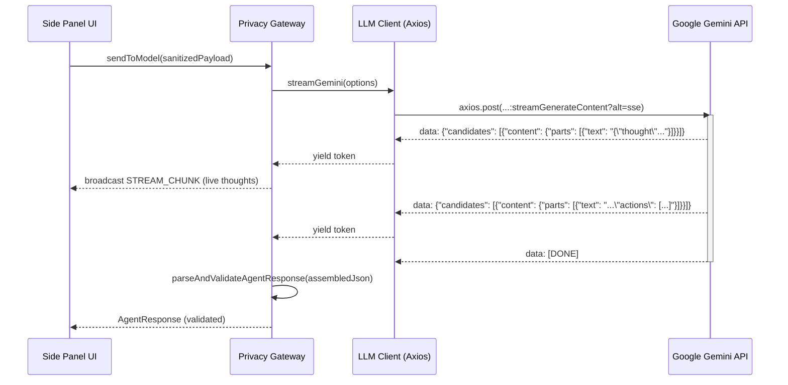

# API & Data Flow

VaultPilot operates on a **Bring-Your-Own-Key (BYOK)** model. The user enters their own free Google Gemini API key from Google AI Studio, eliminating the need for paid subscriptions, central servers, or intermediary proxies.

---

## 1. Google Gemini 2.0 Flash Integration ([`src/background/llm-client.ts`](../src/background/llm-client.ts))

VaultPilot connects directly to Google's official Gemini endpoint using **Axios**:
```
POST https://generativelanguage.googleapis.com/v1beta/models/gemini-2.0-flash:streamGenerateContent?alt=sse
```

### Request Headers
- `Content-Type: application/json`
- `x-goog-api-key: <USER_SUPPLIED_API_KEY>`

### Request Body Configuration
```json
{
  "systemInstruction": {
    "parts": [{ "text": "<SYSTEM_PROMPT>" }]
  },
  "contents": [
    {
      "role": "user",
      "parts": [{ "text": "<SANITIZED_USER_PROMPT>" }]
    }
  ],
  "generationConfig": {
    "responseMimeType": "application/json",
    "temperature": 0.1
  }
}
```

- **`responseMimeType: "application/json"`**: Enforces valid JSON emission from the model.
- **`temperature: 0.1`**: Minimizes model randomness to ensure consistent, deterministic form actions.

---

## 2. Server-Sent Events (SSE) Streaming Pipeline

Instead of waiting several seconds for the full response to generate, VaultPilot streams chunks in real time over SSE:



### SSE Stream Parsing
Implemented in [`src/background/llm-client.ts`](../src/background/llm-client.ts) using `axios` with `adapter: 'fetch'` and `responseType: 'stream'`:
- Leverages Axios for robust request configuration, header management, and error handling.
- Reads incoming byte buffers using `TextDecoder`.
- Splits on newline boundaries (`\n`) and preserves trailing partial chunks in an internal string buffer.
- Strips the `data: ` prefix, parses each candidate chunk, and yields the text delta.
- Implements exponential backoff on HTTP `429` (Rate Limited) responses (1s, 2s, 4s).

---

## 3. Strict Action Schema Validation ([`src/shared/schema.ts`](../src/shared/schema.ts))

All incoming model text is parsed and validated against the strict `AgentResponse` schema before any action is executed:

```typescript
export interface AgentResponse {
  thought: string;
  actions: AgentAction[];
  status: 'continue' | 'done' | 'blocked';
}
```

### Action Types
```typescript
type AgentAction =
  | { type: 'type'; id: number; value: string }
  | { type: 'click'; id: number }
  | { type: 'select'; id: number; value: string }
  | { type: 'check'; id: number; checked: boolean }
  | { type: 'scroll'; direction?: 'up' | 'down'; amount?: number }
  | { type: 'wait'; durationMs?: number }
  | { type: 'ask_user'; question: string; options?: string[] };
```

**Validation Checks**:
- Rejects any action with an unapproved `type` attribute.
- Asserts that element IDs are positive integers matching scanned page items.
- Extracts JSON payload even if wrapped in markdown code blocks (` ```json ... ``` `).
- If validation fails, throws an error and requests a plan correction rather than executing malformed instructions.

---

## 4. Local Storage Architecture (`chrome.storage.local`)

VaultPilot stores all user data in Chrome's sandboxed local storage. Webpages cannot read `chrome.storage.local`.

| Storage Key | Type | Description |
| :--- | :--- | :--- |
| `vp_user_profile` | [`UserProfile`](../src/shared/types.ts#L125) | Single profile containing personal details (Name, DOB, Roll No, etc.). |
| `vp_settings` | [`ExtensionSettings`](../src/shared/types.ts#L170) | API key, model selection, dry run toggle, max steps, and allow-list. |
| `vp_workflows` | [`Workflow[]`](../src/shared/types.ts#L150) | Saved action sequences for 1-second form replay. |
| `vp_audit_logs` | [`AuditLogEntry[]`](../src/shared/types.ts#L110) | Rolling log of last 100 privacy masking events (counts only). |
| `vp_prompt_templates` | [`PromptTemplate[]`](../src/shared/types.ts#L160) | Pinned prompt shortcuts for common portal flows. |

### 1-Click Export & 1-Click Wipe
- **Export** (`exportAllData` in [`src/shared/vault.ts`](../src/shared/vault.ts)): Serializes all local data to a formatted JSON file. **The Gemini API key is stripped before export** (NFR-02) to prevent accidental credential sharing.
- **Wipe** (`wipeAllData` in [`src/shared/vault.ts`](../src/shared/vault.ts)): Calls `chrome.storage.local.clear()` to instantly erase all profile information, API keys, workflows, and audit history.
