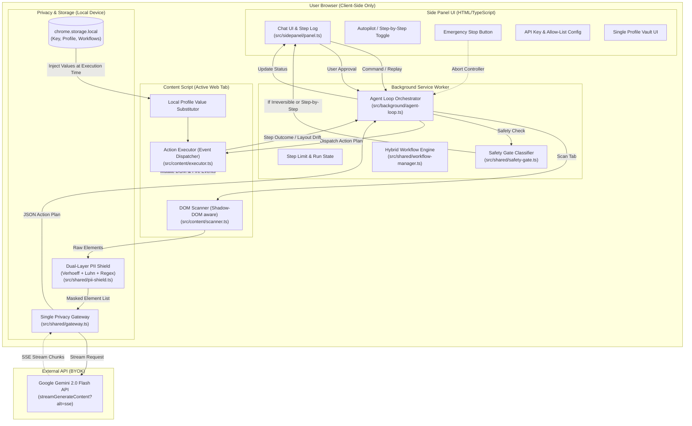

# VaultPilot Architecture

VaultPilot is a privacy-first, Bring-Your-Own-Key (BYOK) AI browser automation agent built as a Chrome Manifest V3 extension. It automates repetitive, multi-step web tasks (such as college admission, exam registration, scholarship portals, and ERP forms) without exposing sensitive personal identifiers to cloud AI models.

---

## 1. High-Level System Architecture

VaultPilot operates **100% client-side** inside the user's browser. There is no VaultPilot server, no proxy, no cloud database, and no intermediary. Requests travel directly from the user's browser to the configured model provider (Google Gemini) using the user's own API key.



---

## 2. Component Directory Structure

```
vaultpilot/
├── manifest.json                     # Chrome Manifest V3 specification
├── package.json                      # Build scripts, Vite, Vitest, TypeScript
├── tsconfig.json                     # Strict TypeScript compiler options
├── vite.config.ts                    # Vite + @crxjs/vite-plugin bundling
├── vitest.config.ts                  # Unit & security test configuration
├── src/
│   ├── background/
│   │   ├── service-worker.ts         # Service worker entry, port messaging
│   │   ├── agent-loop.ts             # Orchestrates Scan -> Shield -> Gateway -> Safety -> Exec
│   │   └── llm-client.ts             # Exclusive egress client for Google Gemini SSE
│   ├── content/
│   │   ├── content-main.ts           # Content script message dispatcher
│   │   ├── scanner.ts                # Shadow-DOM recursive walker & label resolver
│   │   └── executor.ts               # Synthetic event dispatcher & profile substitutor
│   ├── sidepanel/
│   │   ├── index.html                # Modern multi-tab side panel UI
│   │   ├── styles.css                # Slate dark theme UI styles
│   │   └── panel.ts                  # Side panel controller & speech recognition
│   └── shared/
│       ├── types.ts                  # TypeScript schemas, actions, and messages
│       ├── pii-shield.ts             # Verhoeff, Luhn, PAN regex, field heuristics
│       ├── gateway.ts                # Single privacy gateway & zero-knowledge audit
│       ├── schema.ts                 # Strict JSON action schema validator
│       ├── safety-gate.ts            # Action classifier (Benign vs Irreversible)
│       ├── vault.ts                  # Profile store & local {profile.*} substitution
│       ├── workflow-manager.ts       # Reusable workflow replay & template library
│       └── prompts.ts                # Prompt-injection defense & multilingual prompts
├── tests/
│   ├── unit/
│   │   ├── shield.test.ts            # PII Shield mathematical verification
│   │   ├── safety-gate.test.ts       # Action safety & allow-list tests
│   │   ├── schema.test.ts            # Model response JSON validation tests
│   │   ├── vault.test.ts             # Profile substitution & export sanitization
│   │   └── content-scanner-executor.test.ts # DOM traversal & event dispatch tests
│   ├── security/
│   │   └── egress-leak.test.ts       # NFR-11 static code & network egress verification
│   └── fixtures/
│       └── mock-form.html            # Test form with Shadow DOM & prompt-injection trap
├── docs/                             # In-depth architectural & reference docs
│   ├── ARCHITECTURE.md               # System design & component overview (this file)
│   ├── PII_SHIELD_AND_PRIVACY.md     # Mathematical checksums & zero-leak proofs
│   ├── DOM_SCANNER_AND_EXECUTOR.md   # Shadow DOM traversal & synthetic event execution
│   ├── SAFETY_GATE_AND_WORKFLOWS.md  # Human-in-the-loop & self-healing workflows
│   ├── API_AND_DATA_FLOW.md          # BYOK Gemini streaming & schema validation
│   └── CI_CD.md                      # GitHub Actions pipeline & release packaging
└── .github/workflows/
    └── ci.yml                        # Automated CI workflow
```

---

## 3. Core Component Responsibilities

### A. Side Panel UI ([`src/sidepanel/panel.ts`](../src/sidepanel/panel.ts))
- Provides the user interaction interface inside Chrome's dedicated side panel.
- 4 primary tabs:
  1. **Assistant**: Chat message log, live streaming thoughts, confirmation cards for irreversible actions, question cards for clarifications, and pinned prompt templates.
  2. **Workflows**: Saved workflows with 1-second replay and template library.
  3. **Profile Vault**: Form for personal details, 1-click JSON export, and 1-click data wipe.
  4. **Settings**: API key management, model selector, dry-run toggle, execution mode selector (Autopilot vs Step-by-Step), and domain allow-list.
- Includes microphone voice dictation using the Web Speech API and an emergency Stop button.

### B. Background Service Worker ([`src/background/service-worker.ts`](../src/background/service-worker.ts))
- Manifest V3 background worker running in an isolated worker context.
- Maintains long-lived Port connections (`vaultpilot-sidepanel`) with the side panel.
- Coordinates the lifecycle of the singleton [`AgentLoop`](../src/background/agent-loop.ts).
- Routes messages between the side panel and active web tab content scripts.

### C. Agent Loop Orchestrator ([`src/background/agent-loop.ts`](../src/background/agent-loop.ts))
- Executes the primary multi-step automation loop:
  1. Scans the active tab.
  2. Verifies the domain against the user's allow-list.
  3. Redacts personal data using the PII Shield and sends the payload to Gemini via the Privacy Gateway.
  4. Streams the thought process and parses the JSON action response.
  5. Passes each action through the Safety Gate.
  6. Executes approved actions on the webpage.
  7. Re-scans the page and repeats until the task is complete or the 15-step safety ceiling is reached.
- Controls execution state via an `AbortController` for instant cancellation.

### D. Content Scripts ([`src/content/`](../src/content))
- **Scanner** ([`src/content/scanner.ts`](../src/content/scanner.ts)): Deeply traverses the page DOM, traversing open Shadow Roots and accessible same-origin iframes. Assigns stable sequential `data-vp-id` attributes to interactive elements.
- **Executor** ([`src/content/executor.ts`](../src/content/executor.ts)): Performs actions (`type`, `click`, `select`, `check`, `scroll`, `wait`), resolves `{profile.*}` tokens with local vault data, and dispatches synthetic input/change events to update React/Vue/Angular forms.
- **Dispatcher** ([`src/content/content-main.ts`](../src/content/content-main.ts)): Handles incoming messages from the service worker.

### E. Privacy Layer ([`src/shared/`](../src/shared))
- **PII Shield** ([`src/shared/pii-shield.ts`](../src/shared/pii-shield.ts)): Smart dual-layer redaction of Aadhaar (Verhoeff checksum), payment cards (Luhn algorithm), PAN, mobile numbers, and password/OTP fields.
- **Privacy Gateway** ([`src/shared/gateway.ts`](../src/shared/gateway.ts)): Central egress choke-point wrapping all LLM calls and logging zero-knowledge audit counts.
- **Safety Gate** ([`src/shared/safety-gate.ts`](../src/shared/safety-gate.ts)): Enforces user confirmation before irreversible actions (`submit`, `pay`, `delete`).
- **Profile Vault** ([`src/shared/vault.ts`](../src/shared/vault.ts)): Local storage manager in `chrome.storage.local`. Values are never transmitted in prompt payloads.
