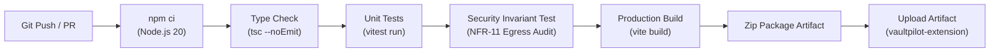

# CI/CD Pipeline & Quality Assurance

This document details the automated Continuous Integration and Continuous Deployment (CI/CD) pipeline for VaultPilot, configured via GitHub Actions in [`.github/workflows/ci.yml`](../.github/workflows/ci.yml).

---

## 1. CI Workflow Overview

The CI pipeline runs automatically on:
- Every `push` to `main` or `master`.
- Every `pull_request` targeting `main` or `master`.



---

## 2. Quality Gates & Steps

### Step 1: Checkout & Environment Setup
Uses `actions/checkout@v4` and `actions/setup-node@v4` with Node.js 20 LTS and automated npm package caching.

### Step 2: Clean Dependency Installation
```bash
npm ci
```
Installs exact dependency versions from `package-lock.json`.

### Step 3: TypeScript Type Checking (Strict Mode)
```bash
npm run typecheck
```
Executes `tsc --noEmit` across all source files and test suites. Strict mode ensures:
- No implicit `any`.
- Strict null and undefined checks.
- No unused local variables or parameters.

### Step 4: Automated Unit & Integration Tests
```bash
npm test
```
Executes Vitest in headless mode across all unit test suites:
- [`tests/unit/shield.test.ts`](../tests/unit/shield.test.ts): Verhoeff checksums for Aadhaar, Luhn for Cards, PAN regex, and password masking.
- [`tests/unit/safety-gate.test.ts`](../tests/unit/safety-gate.test.ts): Action categorization, Autopilot vs. Step-by-Step enforcement, and domain allow-list validation.
- [`tests/unit/schema.test.ts`](../tests/unit/schema.test.ts): Action schema validation and markdown code fence extraction.
- [`tests/unit/vault.test.ts`](../tests/unit/vault.test.ts): Token substitution, 1-click export sanitization, and 1-click wipe.
- [`tests/unit/content-scanner-executor.test.ts`](../tests/unit/content-scanner-executor.test.ts): Shadow DOM scanning, label resolution, and synthetic event dispatching.

### Step 5: Security Egress Invariant Enforcement (NFR-11)
```bash
npm run test:security
```
Statically scans every file in `src/` to confirm:
1. No file other than `src/background/llm-client.ts` calls `generativelanguage.googleapis.com` or initiates external HTTP fetch calls.
2. Form prompts generated by the PII Shield contain **zero clear-text occurrences** of seeded Aadhaar numbers, PAN strings, or passwords.

### Step 6: Extension Bundle Compilation
```bash
npm run build
```
Uses Vite and `@crxjs/vite-plugin` to compile TypeScript into production-ready JavaScript bundles inside `dist/`.

### Step 7: Packaging & Artifact Upload
Packages the `dist/` directory and uploads it using `actions/upload-artifact@v4` as `vaultpilot-extension`. Reviewers and users can download the zip directly from the GitHub Actions run summary and load it into Chrome.

---

## 3. Running All Quality Gates Locally

Before pushing code or opening a PR, you can run all CI checks on your machine:

```bash
# 1. Typecheck
npm run typecheck

# 2. Run all unit and security tests
npm test

# 3. Run security egress check only
npm run test:security

# 4. Compile production build
npm run build
```
