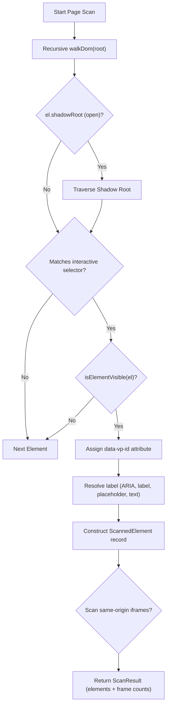

# DOM Scanner & Executor Architecture

This document describes how VaultPilot analyzes webpage structures (including Shadow DOM and iframes) and reliably executes actions across modern JavaScript frameworks (React, Angular, Vue, and vanilla HTML).

---

## 1. DOM Scanner Architecture ([`src/content/scanner.ts`](../src/content/scanner.ts))

The DOM scanner converts a complex, dynamic HTML page into a structured, lightweight list of interactive elements that can be processed by Google Gemini without exhausting the prompt token budget.



---

## 2. Key Scanner Features

### A. Shadow DOM Traversal
Modern web components, design systems, and embedded widgets encapsulate their internal markup inside Shadow DOM trees. Standard methods like `document.querySelectorAll()` cannot see inside shadow roots.

VaultPilot uses a recursive generator function:
```typescript
export function* walkDom(root: ParentNode): Generator<Element> {
  const elements = root.querySelectorAll('*');
  for (let i = 0; i < elements.length; i++) {
    const el = elements[i];
    yield el;
    if (el.shadowRoot) {
      yield* walkDom(el.shadowRoot);
    }
  }
}
```
*Note: Only `open` shadow roots can be inspected via JavaScript. Elements inside `closed` shadow roots are marked as inaccessible per FR-04.*

### B. Same-Origin Iframe Support
Many Indian educational and banking portals host payment gateways or sub-forms inside `<iframe>` elements.
- For same-origin iframes, the scanner accesses `iframe.contentDocument` and traverses its interactive elements.
- For cross-origin iframes (which are blocked by browser security policies), the scanner catches the security error and increments `inaccessibleFramesCount` without crashing.

### C. Visibility & Interaction Filtering (FR-05)
Forms often contain dozens of hidden inputs (CSRF tokens, honeypots, analytics trackers) and elements hidden behind tabs. Sending hidden elements wastes tokens and confuses the AI.

An element is considered visible only if:
1. It is an instance of `HTMLElement` or `SVGElement`.
2. Its bounding rectangle width and height are greater than 0:
   ```typescript
   const rect = el.getBoundingClientRect();
   if (rect.width <= 0 || rect.height <= 0) return false;
   ```
3. Its computed CSS styles confirm it is rendered:
   ```typescript
   const style = window.getComputedStyle(el);
   if (
     style.display === 'none' ||
     style.visibility === 'hidden' ||
     style.opacity === '0' ||
     style.pointerEvents === 'none'
   ) return false;
   ```

### D. Multi-Source Label Resolution Engine
A form input's purpose is not always specified in a standard `<label for="...">` tag. VaultPilot uses a 7-tier resolution hierarchy:
1. **`aria-label`**: Explicit accessibility label.
2. **`aria-labelledby`**: Text from referenced header or title elements.
3. **Explicit `<label for="id">`**: Standard HTML association.
4. **Wrapping `<label>`**: Ancestor label tag enclosing the input.
5. **`placeholder`**: Descriptive watermark text.
6. **Inner Text**: Visible text for buttons, links, or elements with `role="button"`.
7. **Adjacent Text**: Previous sibling elements containing field descriptions.

### E. Persistent Identification (`data-vp-id`)
To map model instructions back to the exact DOM node across re-renders, the scanner assigns a temporary, sequential attribute:
```html
<input data-vp-id="4" type="text" name="applicant_name">
```

---

## 3. DOM Action Executor ([`src/content/executor.ts`](../src/content/executor.ts))

The executor translates structured AI action commands into native browser events.

### A. Supported Actions (FR-08)
- `type`: Focuses the input, scrolls it into view, types the value, and dispatches change events.
- `click`: Scrolls to the element, highlights it, dispatches a complete pointer/mouse event sequence, and invokes `.click()`.
- `select`: Matches options by value or visible text content in `<select>` elements.
- `check`: Sets `checked = true` or `false` on checkboxes and radio buttons.
- `scroll`: Performs smooth viewport scrolling up or down by a specified pixel amount.
- `wait`: Pauses execution for a specified duration (capped at 10,000ms).
- `ask_user`: Prompts the user for clarification when the model lacks necessary input data.

### B. React, Angular & Vue State Synchronization
Modern frontend frameworks override standard input property setters. Simply doing `input.value = "John"` changes the visual DOM value, but does not update React's internal component state. When the form is submitted, the field appears blank.

VaultPilot resolves this by accessing the native prototype descriptor:
```typescript
export function setNativeValue(
  element: HTMLInputElement | HTMLTextAreaElement,
  value: string
): void {
  const prototype = Object.getPrototypeOf(element);
  const descriptor = Object.getOwnPropertyDescriptor(prototype, 'value');

  if (descriptor && descriptor.set) {
    descriptor.set.call(element, value);
  } else {
    element.value = value;
  }

  element.dispatchEvent(new Event('input', { bubbles: true }));
  element.dispatchEvent(new Event('change', { bubbles: true }));
}
```

### C. Client-Side Profile Vault Substitution
When the model outputs `{ "type": "type", "id": 4, "value": "{profile.dob}" }`, the executor intercepts the token immediately before DOM insertion:
```typescript
const resolvedValue = substituteProfileValues(action.value, profile);
```
The real birthdate is retrieved from local browser storage and inserted directly into the page. **The value is never transmitted across the network.**

### D. Visual Feedback & Highlight Overlays
Whenever the agent performs an action (or when user confirmation is requested), a glowing blue highlight overlay (`vp-active-highlight-overlay`) pulses around the target element on the live webpage so the user can easily see what the agent is doing.
