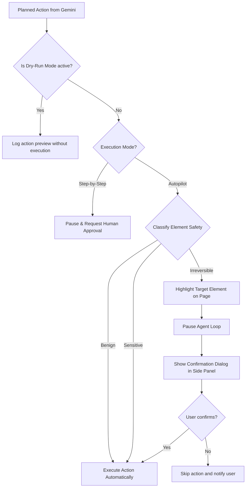

# Safety Gate & Reusable Workflows

VaultPilot is built around a fundamental design principle: **The human stays in control.** Autonomous web agents must never make irreversible decisions (like submitting an application, purchasing a ticket, or transferring funds) without explicit user oversight.

---

## 1. Safety Gate Architecture ([`src/shared/safety-gate.ts`](../src/shared/safety-gate.ts))

The Safety Gate intercepts every planned action before the content script modifies the web page.



---

## 2. Action Classification

Elements and actions are classified into three safety levels:

### A. Benign Actions
- Typing non-sensitive information (e.g. name, email, roll number, address).
- Selecting items from standard dropdowns or comboboxes.
- Clicking navigation buttons (e.g. "Next Page", "Step 2", "Expand Section").
- Scrolling and waiting.
*Behavior*: Executes automatically in Autopilot mode.

### B. Sensitive Actions
- Clicking buttons matching `clear`, `reset`, `cancel`, `edit`, `logout`.
*Behavior*: Logged with high visibility; prompts in Step-by-Step mode.

### C. Irreversible Actions
Identified by matching element labels, names, IDs, or text against the following regex:
```regex
\b(submit|final.?submit|pay|payment|proceed.?to.?pay|buy|purchase|checkout|delete|remove|destroy|terminate|transfer|place.?order|confirm.?and.?submit|agree.?and.?submit|apply.?now)\b
```
*Behavior*: **Mandatory pause**. The agent halts execution, scrolls the button into view, highlights it with a glowing blue border on the webpage, and displays a prominent confirmation card in the side panel. Execution only proceeds when the user clicks **"Approve & Execute"**.

---

## 3. Dual Execution Modes

VaultPilot provides a selector in both the header and settings:

1. **Autopilot Mode (Default)**:
   - Fills forms and navigates multi-step flows continuously without interruptions.
   - Strictly pauses only when encountering irreversible actions (`submit`, `pay`, `delete`).
   - Ideal for routine, 50-field scholarship or exam applications.

2. **Step-by-Step Mode**:
   - Pauses before **every single field modification or click**.
   - Displays the target field label, tag, and value to be entered.
   - Ideal for high-stakes forms or when the user wants to audit every action.

3. **Dry-Run Mode**:
   - Enabled via Settings toggle.
   - The agent reads the page and plans all steps, but **never modifies the DOM**.
   - Outputs a detailed simulation log of what it would have done.

---

## 4. Emergency Stop Mechanism

VaultPilot features a dedicated, prominent **"Stop"** button in the side panel header:
- Instantly invokes `agentLoop.stop()`.
- Aborts the active `AbortController`, halting inflight network streams to Gemini.
- Cancels any pending content script action execution.
- Immediately resets the extension state to `Ready`.

---

## 5. Domain Allow-List Security (FR-18)

To prevent the agent from being tricked into navigating to phishing websites or executing commands on unauthorized domains, VaultPilot includes a **Domain Allow-List**:
- Configured in the **Settings** tab.
- Supports exact domains (`scholarships.gov.in`, `nitbhopal.ac.in`) and wildcards (`*.gov.in`, `*`).
- If a user attempts to run automation on a domain not in the allow-list, the agent halts immediately:
  ```
  Domain "unauthorized-portal.com" is not in your allow-list. Add it in Settings to allow automation.
  ```

---

## 6. Reusable Workflows & Self-Healing Replay ([`src/shared/workflow-manager.ts`](../src/shared/workflow-manager.ts))

Once a user successfully automates a complex multi-step application form, they can click **"Save as Workflow"** in the side panel.

### A. Instant Zero-Token Replay
- When replaying a saved workflow, the extension executes the recorded actions using resilient CSS selectors (`id`, `name`, `data-testid`, or structural paths).
- The form is filled directly from the local profile vault in **under 2 seconds**.
- **Zero API tokens are consumed** and no external network calls are made.

### B. Automated AI Self-Healing
If the target website updates its layout (e.g. an input field's ID or position changed):
1. The content script detects that an element for step $N$ could not be found (`layoutDrift = true`).
2. Instead of failing, the extension triggers **Self-Healing**:
   - It captures the failed step and its intended label.
   - It invokes the Gemini agent loop with a targeted healing prompt:
     > *"Continue filling this form for 'Scholarship Application'. Element changed for field: 'Date of Birth'."*
   - Gemini re-scans the updated page layout, identifies the new element, and resumes the automation.

### C. Pinned Prompt Templates (FR-22)
Users can pin common prompts (e.g. *"Fill Semester Exam Form with my Roll No and Branch"*) as 1-click shortcut buttons in the side panel.
